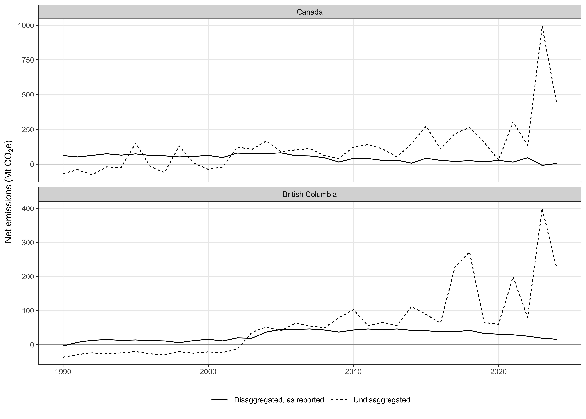
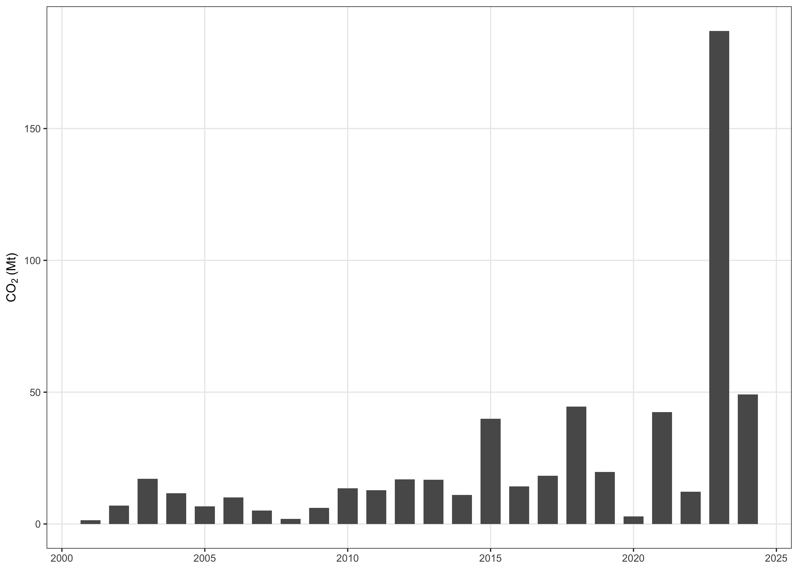
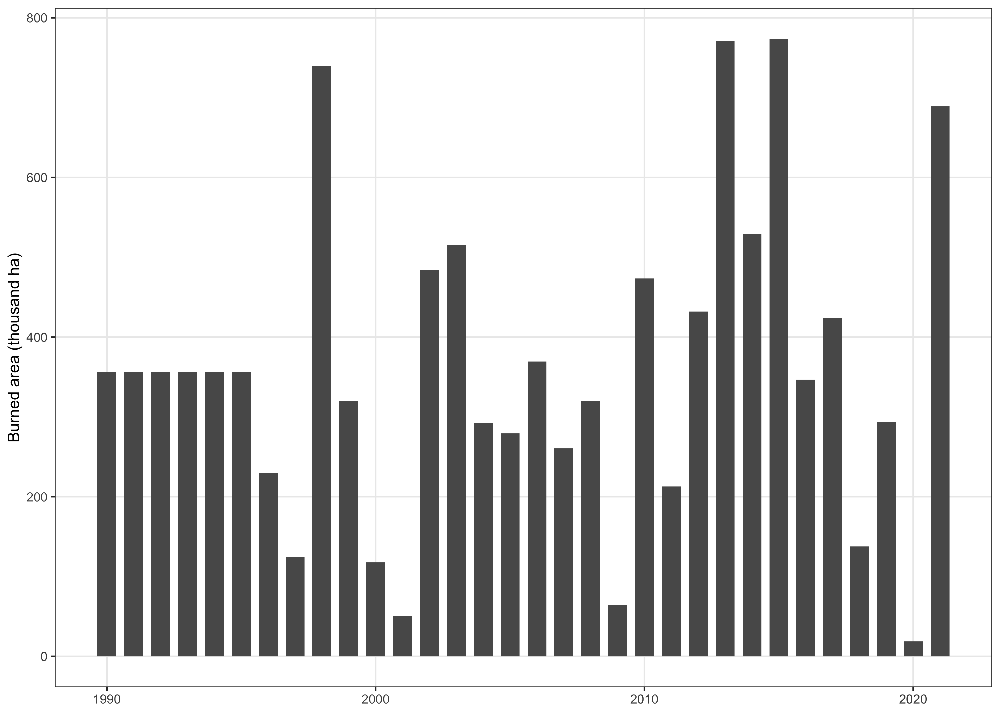

# ipcc-uncertainties

This repository holds a manuscript in development on separating natural from anthropogenic disturbance in jurisdictional forest carbon inventories, following the methods Australia and Canada use to report fire emissions under the IPCC guidelines, and on what that separation does to reported uncertainty. The whole analysis is one Quarto document, `01.manuscript/Manuscript.qmd`, and rendering it with R reproduces every number, table and figure the paper reports.

## Hard rules

These rules were set by Seamus Murphy on 17 September 2026 in these words, "only code that is present inside the manuscript.qmd is considered in the analysis, any code left outside in helper scripts or anywhere are disregarded, and as a result we rely only report calculcation estimates from the runtime by R of the full manuscript markdown."

1. Only code inside `01.manuscript/Manuscript.qmd` is part of the study. A script anywhere else in this repository, or on any machine, is disregarded, and an output it produced is not evidence and is not cited.
2. Every estimate the paper reports is computed by R while the full manuscript renders, and is written into the prose as an inline `r` expression or printed by a chunk. No number is typed by hand.
3. Every chunk is R, shows its code with `echo: true` and runs with `eval: true`. No chunk calls `source()`, reads chunks from another file, includes another document, shells out with `system()` or reads from `05.tasks/`. The pre-render guard `01.manuscript/_tools/check-manuscript-code.py` checks all of this and stops the render on any breach.
4. A step that is slow or fetches data runs inside a guarded chunk, which writes its output to `02.inputs/` or `03.outputs/` and rebuilds that output only when the file is missing. Deleting the output and rendering again reproduces it from the same code and the same seed.
5. Every line that reads a third-party dataset carries, in the comment lines directly above it, the dataset's name and the link it was retrieved from, the DOI as an https link where one exists. The same entry is recorded in `02.inputs/README.md`.
6. The scripts in `01.manuscript/_tools/` format the Word file, count its words and rebuild the results block of this README. None of them computes anything the paper reports.
7. `05.tasks/` holds correspondence and working notes only. Nothing is read from it or written to it by a render, and it is not in git.

A guarded chunk that fetches a dataset takes this form.

```r
#| label: fetch-example
#| echo: true
#| output: false

# <Dataset name as the publisher gives it>
# <https link or DOI the file was retrieved from>
if (!file.exists("02.inputs/example/raw/example.csv")) {
  dir.create("02.inputs/example/raw", recursive = TRUE)
  download.file("<https link>", "02.inputs/example/raw/example.csv", mode = "wb")
}
example <- readr::read_csv("02.inputs/example/raw/example.csv")
```

## Repository layout

| Path | Contents |
|---|---|
| `01.manuscript/Manuscript.qmd` | The manuscript and the entire analysis |
| `01.manuscript/_tools/` | Render hooks that check the manuscript, format the Word file and rebuild this README |
| `02.inputs/` | Input data, with the provenance of every source in `02.inputs/README.md` |
| `03.outputs/PNG/` | Figures written by the render at 300 dpi |
| `03.outputs/TBL/` | Tables written by the render as CSV |
| `04.references/` | `references.bib`, the citation style, the Word reference document and the HTML stylesheet |
| `04.references/literature/` | Saved PDFs of cited work, kept out of git |
| `05.tasks/` | Correspondence and working notes, kept out of git |

## Rendering

Render from the repository root with a bare command, so that both formats are produced, Word first.

```bash
quarto render
```

Quarto runs the steps in this order.

1. `clean-appledouble.py` deletes the `._` files the exFAT drive writes beside every file.
2. `check-manuscript-code.py` stops the render if the manuscript depends on code it does not contain.
3. R renders `Manuscript.qmd` to `Manuscript.docx` and `Manuscript.html`, with every chunk run from the repository root.
4. `format-tables.py` sets every Word table to 16.5 cm wide, 8 pt text, a 1.1 cm header row and 0.6 cm body rows.
5. `stamp-wordcounts.py` counts the Word file, fills the word count paragraph and reports the counts.
6. `build-readme.py` replaces the block between the render markers below with the title, abstract, figures and tables of the current render.

The hooks need Python 3.12 with `lxml`. The manuscript needs R 4.4 with `knitr`, `rmarkdown`, `flextable` and `ggplot2`, read from the global user library.

## Tables and figures

Every table is a chunk labelled `tbl-` with its caption in `#| tbl-cap:`, printed through `fmt_tbl()` from the setup chunk, which centres the header, right-aligns numeric columns and left-aligns text. Every figure is a chunk labelled `fig-` with its caption in `#| fig-cap:`, drawn with `ggplot2` on the setup theme `th` and written to `03.outputs/PNG/` at 300 dpi. The prose refers to each as `@tbl-name` or `@fig-name`, so Quarto numbers them and no caption types its own number. A table the manuscript reports is also written to `03.outputs/TBL/` as CSV by the chunk that builds it.

Significance in a table is marked beside the estimate, `*` for p ≤ 0.05, `**` for p ≤ 0.01, `***` for p ≤ 0.001 and `****` for p ≤ 0.0001, with the legend in the caption. Exact p-values, with a floor of p < 0.001, belong in the prose.

## References

`04.references/references.bib` holds one entry per cited work. Each journal article is taken from its CrossRef record rather than typed, and a report or chapter without a DOI is taken from its own title page. Citations print in APA style from `apa.csl` until a target journal is chosen, when its own style replaces it after its current guide for authors has been read.

## Git rules

Raw third-party data, saved PDFs, `05.tasks/`, the Claude Code state in `.claude/` and `CLAUDE.md`, and every Quarto and knitr intermediate are ignored, because this repository is public and GitHub rejects any file over 100 MB. The manuscript source, the render hooks, the bibliography, the style files, the rendered `Manuscript.docx` and `Manuscript.html`, and the derived figures and tables are committed. Commit subjects are plain imperative sentences that give the reason for the change.

## Traps

A bracketed citation placed directly after a cross-reference is swallowed and never prints, because pandoc reads the bracket as the suffix of the reference beside it. Writing `@fig-test [@kurz2024revised]` gives "Figure 1" and no citation, and the render reports nothing. A comma between the two, `@fig-test, [@kurz2024revised]`, prints both. Every citation is therefore read back out of the render rather than trusted from the source.

## Current render

<!-- render:start -->

## Reported emissions and removals from Canada's managed forest with and without disaggregation of natural disturbances

*Uncertainty under the IPCC 2019 Refinement, jurisdictional credit and a test of the FAOSTAT fire method*

Everything from here to the end marker is generated from the render by `01.manuscript/_tools/build-readme.py`. Do not edit it by hand.

### Abstract

Separating natural disturbance from human activity, as the 2019 Refinement to the guidelines of the Intergovernmental Panel on Climate Change allowed, decided whether Canada and British Columbia had any forest carbon credit to claim in the large fire years of 2017 to 2024. Few studies have run a national inventory through a crediting standard with and without that separation, and the guidance set no length for the record behind it. This study compared the two accounts for Canada and British Columbia using the 2026 national inventory (1990 to 2024) and applied the crediting level, Monte Carlo uncertainty deduction and buffer of the REDD+ Environmental Excellence Standard to 2017 to 2024. It also tested baselines of 13, 20 and 30 years for classing a fire year as natural, and recovered the coefficients behind the fire emissions that the Food and Agriculture Organization published for Canada. The account Canada reported showed reductions in 6 of 8 crediting years, totalling 85.6 million tonnes of carbon dioxide equivalent, while the same land without the separation showed them in 2 years and fell 853.6 million tonnes short in 2023 alone. British Columbia showed 104.6 million tonnes of reductions separated and fell 322 million tonnes short without it. Lengthening the baseline from 13 to 20 years raised the natural disturbance threshold by 74 per cent without changing the years it marked, and the two deductions left nothing to issue once uncertainty reached 235 per cent. The Food and Agriculture Organization applied savanna and grassland emission factors to Canadian forest fires, putting their methane at 49 per cent of its cited method. It also classed 86 per cent of the burned area as savanna, grassland or shrubland, for which it reported no carbon dioxide. Crediting standards that relied on the separation therefore needed a stated record length, a stated regrowth period and an uncertainty deduction taken on gross rather than net fluxes.

### Results

Every figure and table below is reproduced from the current render, in the order it appears in the manuscript.

#### Table 1

*Datasets this study read, with the release used and what each one supplies.*

<table>
<thead>
<tr>
<th width="2000" align="left">Dataset</th>
<th width="2000" align="left">Publisher</th>
<th width="2000" align="left">Supplies</th>
<th width="2000" align="left">Period</th>
</tr>
</thead>
<tbody>
<tr><td align="left">FAOSTAT Emissions from Fires (GI)</td><td align="left">FAO</td><td align="left">Burned area, burned biomass and emissions by country and year</td><td align="left">1990-2024</td></tr>
<tr><td align="left">FAO AllFires_OrganicSoils table</td><td align="left">FAO</td><td align="left">Organic soil fire values set to zero in the published domain</td><td align="left">1990-2021</td></tr>
<tr><td align="left">MODIS MCD64A1 Collection 6.1</td><td align="left">NASA</td><td align="left">Monthly burned area at 500 m, the input FAOSTAT aggregates</td><td align="left">2000-2024</td></tr>
<tr><td align="left">MODIS MCD12Q1 Collection 6.1</td><td align="left">NASA</td><td align="left">Annual land cover at 500 m, the vegetation strata FAOSTAT applies</td><td align="left">2001-2023</td></tr>
</tbody>
</table>

#### Figure 1



*Net emissions of the land use sector for Canada and British Columbia, 1990 to 2024, in the account Canada reports, with natural disturbance separated, and in the undisaggregated account, the reported total plus the natural disturbance component. Positive values are emissions and negative values are removals.*

#### Table 2

*Carbon dioxide from forest fires in Canada as FAOSTAT computes it at Tier 1, with the burned area it was derived from. The series begins in 2001 because that is the first year of the MODIS burned area input.*

<table>
<thead>
<tr>
<th width="2000" align="left">Year</th>
<th width="2000" align="left">Burned area (ha)</th>
<th width="2000" align="left">CH4 (kt)</th>
<th width="2000" align="left">CO2 (kt)</th>
</tr>
</thead>
<tbody>
<tr><td align="left">2,001</td><td align="left">19,773.77</td><td align="left">2.0249</td><td align="left">1,420.085</td></tr>
<tr><td align="left">2,002</td><td align="left">101,943.82</td><td align="left">9.9021</td><td align="left">6,944.383</td></tr>
<tr><td align="left">2,003</td><td align="left">230,304.01</td><td align="left">24.4737</td><td align="left">17,163.481</td></tr>
<tr><td align="left">2,004</td><td align="left">167,748.37</td><td align="left">16.5832</td><td align="left">11,629.860</td></tr>
<tr><td align="left">2,005</td><td align="left">97,542.49</td><td align="left">9.5089</td><td align="left">6,668.648</td></tr>
<tr><td align="left">2,006</td><td align="left">146,045.61</td><td align="left">14.3965</td><td align="left">10,096.295</td></tr>
<tr><td align="left">2,007</td><td align="left">67,697.31</td><td align="left">7.2428</td><td align="left">5,079.409</td></tr>
<tr><td align="left">2,008</td><td align="left">27,018.12</td><td align="left">2.7528</td><td align="left">1,930.524</td></tr>
<tr><td align="left">2,009</td><td align="left">82,928.65</td><td align="left">8.6638</td><td align="left">6,075.961</td></tr>
<tr><td align="left">2,010</td><td align="left">176,295.60</td><td align="left">19.3049</td><td align="left">13,538.611</td></tr>
<tr><td align="left">2,011</td><td align="left">192,658.86</td><td align="left">18.2590</td><td align="left">12,805.143</td></tr>
<tr><td align="left">2,012</td><td align="left">247,003.14</td><td align="left">24.1714</td><td align="left">16,951.493</td></tr>
<tr><td align="left">2,013</td><td align="left">252,611.77</td><td align="left">23.9457</td><td align="left">16,793.223</td></tr>
<tr><td align="left">2,014</td><td align="left">147,474.89</td><td align="left">15.7320</td><td align="left">11,032.937</td></tr>
<tr><td align="left">2,015</td><td align="left">593,947.85</td><td align="left">56.8983</td><td align="left">39,902.996</td></tr>
<tr><td align="left">2,016</td><td align="left">213,589.28</td><td align="left">20.2858</td><td align="left">14,226.529</td></tr>
<tr><td align="left">2,017</td><td align="left">240,883.06</td><td align="left">26.1074</td><td align="left">18,309.234</td></tr>
<tr><td align="left">2,018</td><td align="left">606,890.34</td><td align="left">63.5046</td><td align="left">44,536.078</td></tr>
<tr><td align="left">2,019</td><td align="left">296,516.62</td><td align="left">28.1474</td><td align="left">19,739.897</td></tr>
<tr><td align="left">2,020</td><td align="left">40,890.88</td><td align="left">4.0396</td><td align="left">2,832.990</td></tr>
<tr><td align="left">2,021</td><td align="left">575,038.62</td><td align="left">60.5564</td><td align="left">42,468.496</td></tr>
<tr><td align="left">2,022</td><td align="left">172,378.52</td><td align="left">17.4766</td><td align="left">12,256.448</td></tr>
<tr><td align="left">2,023</td><td align="left">2,749,985.32</td><td align="left">266.6721</td><td align="left">187,018.316</td></tr>
<tr><td align="left">2,024</td><td align="left">717,855.47</td><td align="left">70.1121</td><td align="left">49,169.902</td></tr>
</tbody>
</table>

#### Figure 2



*Carbon dioxide from forest fires in Canada, 2001 to 2024, as computed by FAOSTAT at Tier 1 from MODIS burned area.*

#### Table 3

*Carbon dioxide from fires in other forest in Canada, as FAOSTAT computes it at Tier 1 and as Canada reported it to the UNFCCC, for the years both are available. FAOSTAT carries the reported series inside the same domain.*

<table>
<thead>
<tr>
<th width="2000" align="left">Year</th>
<th width="2000" align="left">FAO Tier 1 (kt)</th>
<th width="2000" align="left">UNFCCC (kt)</th>
<th width="2000" align="left">Ratio</th>
</tr>
</thead>
<tbody>
<tr><td align="left">2,001</td><td align="left">1,420.085</td><td align="left">5,937.187</td><td align="left">0.2</td></tr>
<tr><td align="left">2,002</td><td align="left">6,944.383</td><td align="left">6,600.562</td><td align="left">1.1</td></tr>
<tr><td align="left">2,003</td><td align="left">17,163.481</td><td align="left">6,477.020</td><td align="left">2.6</td></tr>
<tr><td align="left">2,004</td><td align="left">11,629.860</td><td align="left">6,223.502</td><td align="left">1.9</td></tr>
<tr><td align="left">2,005</td><td align="left">6,668.648</td><td align="left">7,252.098</td><td align="left">0.9</td></tr>
<tr><td align="left">2,006</td><td align="left">10,096.295</td><td align="left">6,247.804</td><td align="left">1.6</td></tr>
<tr><td align="left">2,007</td><td align="left">5,079.409</td><td align="left">5,603.096</td><td align="left">0.9</td></tr>
<tr><td align="left">2,008</td><td align="left">1,930.524</td><td align="left">4,643.541</td><td align="left">0.4</td></tr>
<tr><td align="left">2,009</td><td align="left">6,075.961</td><td align="left">3,987.953</td><td align="left">1.5</td></tr>
<tr><td align="left">2,010</td><td align="left">13,538.611</td><td align="left">4,836.967</td><td align="left">2.8</td></tr>
<tr><td align="left">2,011</td><td align="left">12,805.143</td><td align="left">4,878.594</td><td align="left">2.6</td></tr>
<tr><td align="left">2,012</td><td align="left">16,951.493</td><td align="left">4,999.909</td><td align="left">3.4</td></tr>
<tr><td align="left">2,013</td><td align="left">16,793.223</td><td align="left">4,814.442</td><td align="left">3.5</td></tr>
<tr><td align="left">2,014</td><td align="left">11,032.937</td><td align="left">4,260.117</td><td align="left">2.6</td></tr>
<tr><td align="left">2,015</td><td align="left">39,902.996</td><td align="left">5,032.216</td><td align="left">7.9</td></tr>
<tr><td align="left">2,016</td><td align="left">14,226.529</td><td align="left">4,368.008</td><td align="left">3.3</td></tr>
<tr><td align="left">2,017</td><td align="left">18,309.234</td><td align="left">3,840.632</td><td align="left">4.8</td></tr>
<tr><td align="left">2,018</td><td align="left">44,536.078</td><td align="left">3,553.743</td><td align="left">12.5</td></tr>
<tr><td align="left">2,019</td><td align="left">19,739.897</td><td align="left">2,506.846</td><td align="left">7.9</td></tr>
<tr><td align="left">2,020</td><td align="left">2,832.990</td><td align="left">2,466.193</td><td align="left">1.1</td></tr>
</tbody>
</table>

#### Table 4

*Fuel consumption and emission factors FAOSTAT applied to fires in Canada, 2001 to 2024, recovered from its own published values by dividing the biomass burned of each item by its burned area and each emission by the biomass burned, with the rows of Tables 2.4 and 2.5 of the 2006 IPCC Guidelines that the values equal. Carbon dioxide is not reported for the savanna, grassland and shrubland items.*

<table>
<thead>
<tr>
<th width="2000" align="left">Item</th>
<th width="2000" align="left">Burned area (kha a year)</th>
<th width="2000" align="left">Fuel (t/ha)</th>
<th width="2000" align="left">Table 2.4 row</th>
<th width="2000" align="left">CO2 (g/kg)</th>
<th width="2000" align="left">CH4 (g/kg)</th>
<th width="2000" align="left">N2O (g/kg)</th>
<th width="2000" align="left">Table 2.5 row</th>
</tr>
</thead>
<tbody>
<tr><td align="left">Other forest</td><td align="left">340</td><td align="left">41.2 to 47.6</td><td align="left">All boreal forest to All other temperate forests</td><td align="left">1,613</td><td align="left">2.3</td><td align="left">0.21</td><td align="left">Savanna and grassland</td></tr>
<tr><td align="left">Closed shrubland</td><td align="left">0</td><td align="left">26.7</td><td align="left">Shrubland (general)</td><td align="left">not reported</td><td align="left">2.3</td><td align="left">0.21</td><td align="left">Savanna and grassland</td></tr>
<tr><td align="left">Grassland</td><td align="left">56</td><td align="left">4.1</td><td align="left">Grassland, mid or late dry season burns</td><td align="left">not reported</td><td align="left">2.3</td><td align="left">0.21</td><td align="left">Savanna and grassland</td></tr>
<tr><td align="left">Open shrubland</td><td align="left">35</td><td align="left">14.3</td><td align="left">All shrublands</td><td align="left">not reported</td><td align="left">2.3</td><td align="left">0.21</td><td align="left">Savanna and grassland</td></tr>
<tr><td align="left">Savanna</td><td align="left">754</td><td align="left">4.1</td><td align="left">Grassland, mid or late dry season burns</td><td align="left">not reported</td><td align="left">2.3</td><td align="left">0.21</td><td align="left">Savanna and grassland</td></tr>
<tr><td align="left">Woody savanna</td><td align="left">1,195</td><td align="left">3.3</td><td align="left">Savanna woodland, mid or late dry season burns</td><td align="left">not reported</td><td align="left">2.3</td><td align="left">0.21</td><td align="left">Savanna and grassland</td></tr>
</tbody>
</table>

#### Table 5

*The natural disturbance threshold applied to Canadian forest fire emissions under three baseline lengths. The threshold is the baseline mean plus two standard deviations, and the years listed are those the rule classifies as natural.*

<table>
<thead>
<tr>
<th width="2000" align="left">Baseline (years)</th>
<th width="2000" align="left">Period</th>
<th width="2000" align="left">Threshold (kt)</th>
<th width="2000" align="left">Years classified natural</th>
</tr>
</thead>
<tbody>
<tr><td align="left">13</td><td align="left">2001-2013</td><td align="left">20,837</td><td align="left">2015, 2018, 2021, 2023, 2024</td></tr>
<tr><td align="left">20</td><td align="left">2001-2020</td><td align="left">36,301</td><td align="left">2015, 2018, 2021, 2023, 2024</td></tr>
<tr><td align="left">30</td><td align="left"></td><td align="left"></td><td align="left">baseline longer than the series</td></tr>
</tbody>
</table>

#### Table 6

*Emissions and reductions for Canada’s managed land under the two accounts, 2017 to 2024, on a 2012 to 2016 reference period. The disaggregated account is the human activity component Canada reports; the undisaggregated account is the sum of the human activity and natural disturbance components. A negative reduction is emissions above the crediting level, which the standard treats as a reversal.*

<table>
<thead>
<tr>
<th width="2000" align="left">Year</th>
<th width="2000" align="left">Disaggregated emissions (Mt)</th>
<th width="2000" align="left">Disaggregated reductions (Mt)</th>
<th width="2000" align="left">Undisaggregated emissions (Mt)</th>
<th width="2000" align="left">Undisaggregated reductions (Mt)</th>
</tr>
</thead>
<tbody>
<tr><td align="left">2,017</td><td align="left">19.0</td><td align="left">6.7</td><td align="left">219.0</td><td align="left">-81.3</td></tr>
<tr><td align="left">2,018</td><td align="left">24.0</td><td align="left">1.7</td><td align="left">264.0</td><td align="left">-126.3</td></tr>
<tr><td align="left">2,019</td><td align="left">16.0</td><td align="left">9.7</td><td align="left">156.0</td><td align="left">-18.3</td></tr>
<tr><td align="left">2,020</td><td align="left">26.0</td><td align="left">-0.3</td><td align="left">28.7</td><td align="left">109.0</td></tr>
<tr><td align="left">2,021</td><td align="left">14.0</td><td align="left">11.7</td><td align="left">304.0</td><td align="left">-166.3</td></tr>
<tr><td align="left">2,022</td><td align="left">46.0</td><td align="left">-20.3</td><td align="left">135.0</td><td align="left">2.7</td></tr>
<tr><td align="left">2,023</td><td align="left">-8.7</td><td align="left">34.4</td><td align="left">991.3</td><td align="left">-853.6</td></tr>
<tr><td align="left">2,024</td><td align="left">4.3</td><td align="left">21.4</td><td align="left">434.3</td><td align="left">-296.6</td></tr>
</tbody>
</table>

#### Table 7

*Emissions and reductions for British Columbia under the two accounts, 2017 to 2024, on a 2012 to 2016 reference period. Both components are the provincial figures of the national inventory, and the burned area share is the province’s share of the area burned in Canada.*

<table>
<thead>
<tr>
<th width="2000" align="left">Year</th>
<th width="2000" align="left">Burned area share (%)</th>
<th width="2000" align="left">Disaggregated emissions (Mt)</th>
<th width="2000" align="left">Disaggregated reductions (Mt)</th>
<th width="2000" align="left">Undisaggregated emissions (Mt)</th>
<th width="2000" align="left">Undisaggregated reductions (Mt)</th>
</tr>
</thead>
<tbody>
<tr><td align="left">2,017</td><td align="left">35.9</td><td align="left">38</td><td align="left">4.2</td><td align="left">228</td><td align="left">-151</td></tr>
<tr><td align="left">2,018</td><td align="left">60.5</td><td align="left">42</td><td align="left">0.2</td><td align="left">272</td><td align="left">-195</td></tr>
<tr><td align="left">2,019</td><td align="left">1.5</td><td align="left">33</td><td align="left">9.2</td><td align="left">65</td><td align="left">12</td></tr>
<tr><td align="left">2,020</td><td align="left">6.6</td><td align="left">31</td><td align="left">11.2</td><td align="left">60</td><td align="left">17</td></tr>
<tr><td align="left">2,021</td><td align="left">21.1</td><td align="left">29</td><td align="left">13.2</td><td align="left">199</td><td align="left">-122</td></tr>
<tr><td align="left">2,022</td><td align="left">9.0</td><td align="left">25</td><td align="left">17.2</td><td align="left">80</td><td align="left">-3</td></tr>
<tr><td align="left">2,023</td><td align="left">22.2</td><td align="left">19</td><td align="left">23.2</td><td align="left">399</td><td align="left">-322</td></tr>
<tr><td align="left">2,024</td><td align="left">20.8</td><td align="left">16</td><td align="left">26.2</td><td align="left">226</td><td align="left">-149</td></tr>
</tbody>
</table>

#### Table 8

*Reductions and their uncertainty for Canada under the two accounts, from 10,000 Monte Carlo draws using the annual flux uncertainty published for Canada’s forest carbon model. The interval is the 90 per cent interval the standard requires, its half width expressed against the mean reduction of the same draws, and the deduction is what the standard’s adjustment factor takes from it. A percentage is printed only where the mean reduction is positive, since a percentage of a shortfall carries no meaning, and the undisaggregated deduction is therefore not reported.*

<table>
<thead>
<tr>
<th width="2000" align="left">Year</th>
<th width="2000" align="left">Disaggregated reductions (Mt)</th>
<th width="2000" align="left">Disaggregated interval (% of mean)</th>
<th width="2000" align="left">Disaggregated deduction (%)</th>
<th width="2000" align="left">Undisaggregated reductions (Mt)</th>
<th width="2000" align="left">Undisaggregated interval (% of mean)</th>
</tr>
</thead>
<tbody>
<tr><td align="left">2,017</td><td align="left">6.7</td><td align="left">821</td><td align="left">261.6</td><td align="left">-80.8</td><td align="left"></td></tr>
<tr><td align="left">2,018</td><td align="left">1.5</td><td align="left">3,692</td><td align="left">1,176.9</td><td align="left">-126.5</td><td align="left"></td></tr>
<tr><td align="left">2,019</td><td align="left">9.7</td><td align="left">574</td><td align="left">182.9</td><td align="left">-18.5</td><td align="left"></td></tr>
<tr><td align="left">2,020</td><td align="left">-0.7</td><td align="left"></td><td align="left"></td><td align="left">109.4</td><td align="left">52</td></tr>
<tr><td align="left">2,021</td><td align="left">12.0</td><td align="left">458</td><td align="left">146.0</td><td align="left">-165.7</td><td align="left"></td></tr>
<tr><td align="left">2,022</td><td align="left">-20.2</td><td align="left"></td><td align="left"></td><td align="left">2.6</td><td align="left">2,126</td></tr>
<tr><td align="left">2,023</td><td align="left">34.4</td><td align="left">163</td><td align="left">51.8</td><td align="left">-853.8</td><td align="left"></td></tr>
<tr><td align="left">2,024</td><td align="left">21.4</td><td align="left">264</td><td align="left">84.2</td><td align="left">-296.9</td><td align="left"></td></tr>
</tbody>
</table>

#### Table 9

*The share of gross reductions and removals a jurisdiction keeps under the standard, by the reported uncertainty. The uncertainty deduction follows Equation 11 and the buffer follows Table 2 of the standard. The last column is the worst case in the five years after a reversal, when the buffer rises by five percentage points.*

<table>
<thead>
<tr>
<th width="2000" align="left">Uncertainty, 90% interval half width (%)</th>
<th width="2000" align="left">Uncertainty deduction (%)</th>
<th width="2000" align="left">Kept, 25% buffer (%)</th>
<th width="2000" align="left">Kept, 5% buffer (%)</th>
<th width="2000" align="left">Kept, 30% buffer after a reversal (%)</th>
</tr>
</thead>
<tbody>
<tr><td align="left">10</td><td align="left">3.2</td><td align="left">71.8</td><td align="left">91.8</td><td align="left">66.8</td></tr>
<tr><td align="left">20</td><td align="left">6.4</td><td align="left">68.6</td><td align="left">88.6</td><td align="left">63.6</td></tr>
<tr><td align="left">30</td><td align="left">9.6</td><td align="left">65.4</td><td align="left">85.4</td><td align="left">60.4</td></tr>
<tr><td align="left">50</td><td align="left">15.9</td><td align="left">59.1</td><td align="left">79.1</td><td align="left">54.1</td></tr>
<tr><td align="left">75</td><td align="left">23.9</td><td align="left">51.1</td><td align="left">71.1</td><td align="left">46.1</td></tr>
<tr><td align="left">100</td><td align="left">31.9</td><td align="left">43.1</td><td align="left">63.1</td><td align="left">38.1</td></tr>
<tr><td align="left">150</td><td align="left">47.8</td><td align="left">27.2</td><td align="left">47.2</td><td align="left">22.2</td></tr>
<tr><td align="left">200</td><td align="left">63.8</td><td align="left">11.2</td><td align="left">31.2</td><td align="left">6.2</td></tr>
</tbody>
</table>

#### Table 10

*Burned area and emissions from fires in organic soils in Canada, as FAO computed them and then set them to zero in the published Emissions from Fires domain. Values for 1990 to 1995 are the average of the reconstructed series rather than observations, which is why they do not vary.*

<table>
<thead>
<tr>
<th width="2000" align="left">Year</th>
<th width="2000" align="left">CH4 (kt)</th>
<th width="2000" align="left">Burned area (ha)</th>
<th width="2000" align="left">CO2 (kt)</th>
</tr>
</thead>
<tbody>
<tr><td align="left">1,990</td><td align="left">257.61615</td><td align="left">356,482.42</td><td align="left">32,682.923</td></tr>
<tr><td align="left">1,991</td><td align="left">257.61615</td><td align="left">356,482.42</td><td align="left">32,682.923</td></tr>
<tr><td align="left">1,992</td><td align="left">257.61615</td><td align="left">356,482.42</td><td align="left">32,682.923</td></tr>
<tr><td align="left">1,993</td><td align="left">257.61615</td><td align="left">356,482.42</td><td align="left">32,682.923</td></tr>
<tr><td align="left">1,994</td><td align="left">257.61615</td><td align="left">356,482.42</td><td align="left">32,682.923</td></tr>
<tr><td align="left">1,995</td><td align="left">257.61615</td><td align="left">356,482.42</td><td align="left">32,682.923</td></tr>
<tr><td align="left">1,996</td><td align="left">315.23052</td><td align="left">229,625.96</td><td align="left">25,809.499</td></tr>
<tr><td align="left">1,997</td><td align="left">170.40705</td><td align="left">124,131.01</td><td align="left">13,952.077</td></tr>
<tr><td align="left">1,998</td><td align="left">1,015.27769</td><td align="left">739,567.08</td><td align="left">83,125.860</td></tr>
<tr><td align="left">1,999</td><td align="left">439.44356</td><td align="left">320,107.49</td><td align="left">35,979.441</td></tr>
<tr><td align="left">2,000</td><td align="left">161.68439</td><td align="left">117,777.09</td><td align="left">13,237.909</td></tr>
<tr><td align="left">2,001</td><td align="left">30.23739</td><td align="left">50,904.70</td><td align="left">4,458.335</td></tr>
<tr><td align="left">2,002</td><td align="left">287.54083</td><td align="left">484,075.47</td><td align="left">42,396.298</td></tr>
<tr><td align="left">2,003</td><td align="left">306.03608</td><td align="left">515,212.26</td><td align="left">45,123.320</td></tr>
<tr><td align="left">2,004</td><td align="left">173.45735</td><td align="left">292,015.74</td><td align="left">25,575.323</td></tr>
<tr><td align="left">2,005</td><td align="left">165.94913</td><td align="left">279,375.64</td><td align="left">24,468.277</td></tr>
<tr><td align="left">2,006</td><td align="left">219.41289</td><td align="left">369,381.97</td><td align="left">32,351.212</td></tr>
<tr><td align="left">2,007</td><td align="left">154.83941</td><td align="left">260,672.40</td><td align="left">22,830.210</td></tr>
<tr><td align="left">2,008</td><td align="left">189.87328</td><td align="left">319,651.99</td><td align="left">27,995.761</td></tr>
<tr><td align="left">2,009</td><td align="left">38.33478</td><td align="left">64,536.66</td><td align="left">5,652.250</td></tr>
<tr><td align="left">2,010</td><td align="left">281.27927</td><td align="left">473,534.13</td><td align="left">41,473.066</td></tr>
<tr><td align="left">2,011</td><td align="left">126.49251</td><td align="left">212,950.35</td><td align="left">18,650.618</td></tr>
<tr><td align="left">2,012</td><td align="left">256.69793</td><td align="left">432,151.40</td><td align="left">37,848.683</td></tr>
<tr><td align="left">2,013</td><td align="left">457.77889</td><td align="left">770,671.53</td><td align="left">67,496.954</td></tr>
<tr><td align="left">2,014</td><td align="left">314.12631</td><td align="left">528,832.17</td><td align="left">46,316.179</td></tr>
<tr><td align="left">2,015</td><td align="left">459.60190</td><td align="left">773,740.57</td><td align="left">67,765.747</td></tr>
<tr><td align="left">2,016</td><td align="left">205.94202</td><td align="left">346,703.73</td><td align="left">30,365.006</td></tr>
<tr><td align="left">2,017</td><td align="left">251.91707</td><td align="left">424,102.81</td><td align="left">37,143.773</td></tr>
<tr><td align="left">2,018</td><td align="left">81.74237</td><td align="left">137,613.42</td><td align="left">12,052.459</td></tr>
<tr><td align="left">2,019</td><td align="left">174.33455</td><td align="left">293,492.50</td><td align="left">25,704.660</td></tr>
<tr><td align="left">2,020</td><td align="left">11.04954</td><td align="left">18,601.91</td><td align="left">1,629.193</td></tr>
<tr><td align="left">2,021</td><td align="left">409.33311</td><td align="left">689,112.98</td><td align="left">60,353.893</td></tr>
</tbody>
</table>

#### Figure 3



*Burned area of fires in organic soils in Canada, 1990 to 2021, from the FAO table that the published domain replaces with zeros. The flat section to 1995 is the filled part of the series and the rest is derived from satellite observations.*

<!-- render:end -->
